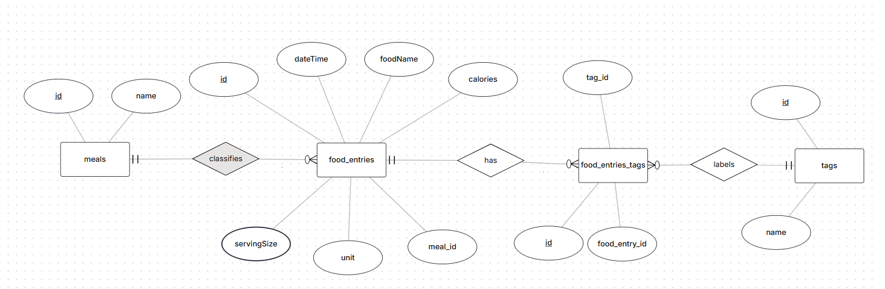

# CICO Tracker

A food diary for logging calories, serving sizes, meals, and dietary tags. Use the food name and meal filters together to find entries.

Built with Node.js, Express, EJS, MariaDB, and plain CSS. The app supports creating, viewing, editing, and deleting food entries. Serving sizes accept decimals, such as `0.75`.

## Database design



The database uses four tables. Each row in `food_entries` belongs to one meal from `meals`. The `food_entries_tags` junction table connects food entries to `tags` and prevents the same tag from being assigned to an entry twice.

## Run in GitHub Codespaces

1. Open the repository on GitHub and choose **Code → Codespaces → Create codespace on main**. The included `.devcontainer` configuration starts MariaDB and sets up the Node.js environment.
2. In the Codespaces terminal, from the folder containing `package.json`, connect to MariaDB. Use the demo password configured by `MYSQL_ROOT_PASSWORD` in `.devcontainer/docker-compose.yml`.

   ```bash
   mariadb -h 127.0.0.1 -P 3306 -u root -p
   ```

3. At the MariaDB prompt, run the setup scripts in order **once per fresh database**. Stop if a script reports an error.

   ```sql
   SOURCE schema.sql
   SOURCE migrations/01_add_meals_table.sql
   SOURCE migrations/02_add_food_entries_meals_fk.sql
   SOURCE migrations/03_migrate_existing_meals.sql
   SOURCE migrations/04_add_tags_table.sql
   SOURCE migrations/05_add_food_entry_tag_id.sql
   SOURCE migrations/06_allow_decimal_serving_size.sql

   USE cico_tracker;
   SHOW TABLES;
   ```

   Expect `food_entries`, `food_entries_tags`, `meals`, and `tags`. Type `exit` to return to the terminal.

4. Create a `.env` file beside `package.json`. Replace the password placeholder with your MariaDB password. Keep this file out of Git and the submission ZIP.

   ```dotenv
   DB_HOST=127.0.0.1
   DB_PORT=3306
   DB_USER=root
   DB_PASSWORD=your_database_password
   DB_NAME=cico_tracker
   PORT=3000
   ```

5. Install dependencies and start the app.

   ```bash
   npm ci
   npm start
   ```

6. Open **Ports → 3000 → Open in Browser**. If the Codespace stops, reopen it and run `npm start` again.

### Run locally

Start your local MariaDB server and use the same schema setup and `.env` settings above with your local database credentials. From the project folder, run `npm ci` and `npm start` (or `npm.cmd ci` and `npm.cmd start` in Windows PowerShell). Open [localhost:3000](http://localhost:3000/).

## Assessment demo

1. Add an **Oatmeal** entry under **Breakfast**.
2. Search for **Oatmeal** with **Breakfast** selected. Switch the meal to **Lunch** to show that the breakfast entry is excluded.
3. Edit the serving size and refresh the list to verify that the change was saved.
4. Use a separate test entry to demonstrate the delete confirmation. Keep the breakfast oatmeal entry for the SQL search demo.
5. Connect to MariaDB from the project folder and run this at the MariaDB prompt.

   ```sql
   SOURCE assessment-demo.sql
   ```

   The script lists entries, filters by food name and meal, and shows daily counts, calorie totals, and averages. It then inserts a temporary entry, reads it, updates its calories from 150 to 180, and deletes it. The final count for the temporary entry should be zero.
